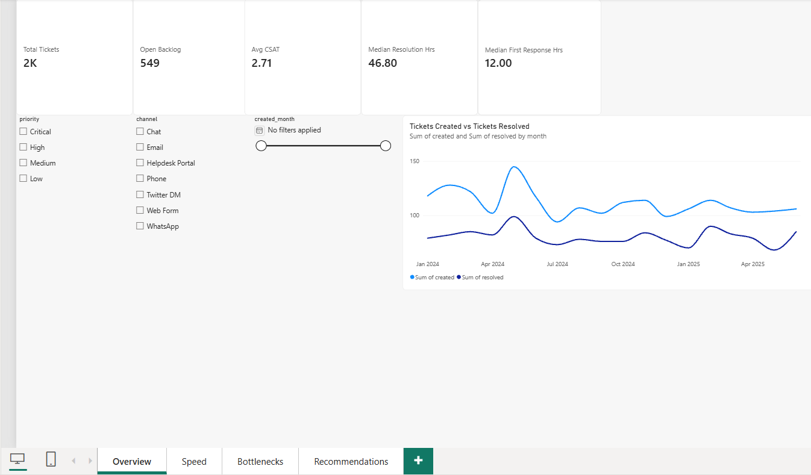
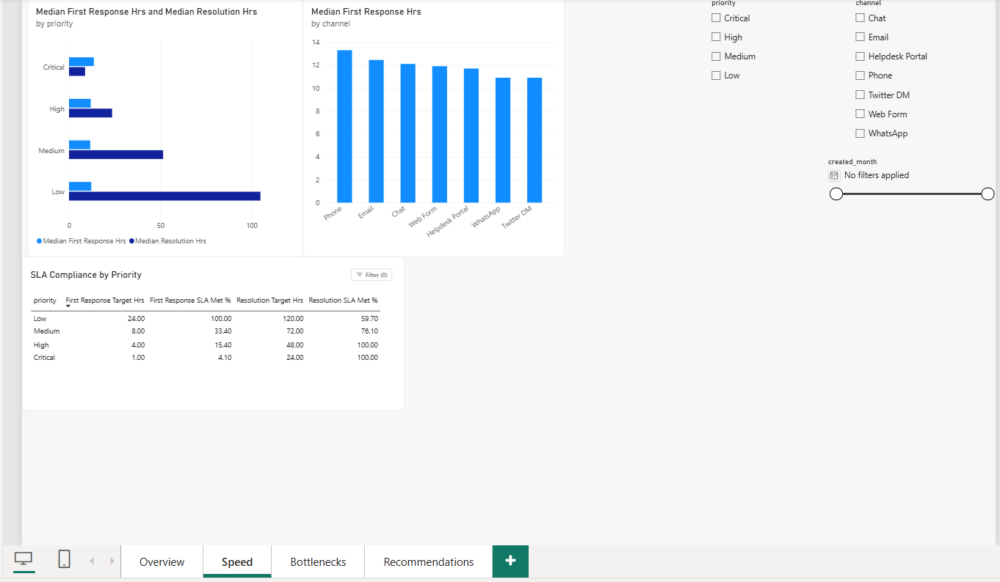
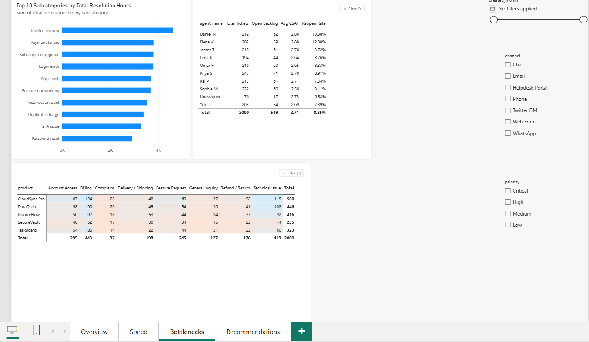
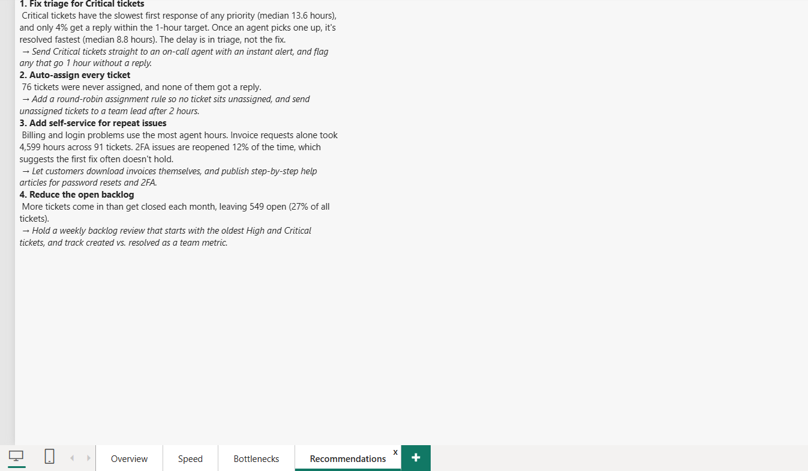

# Service Desk Ticket Analysis — SQL + Power BI

Analysis of 2,000 support tickets to find what slows down resolution, where the backlog builds up, and which changes would cut it. Data is cleaned and modeled in **PostgreSQL**, then visualized in a four-page **Power BI** dashboard with recommendations.



## Key findings

| Finding | Evidence |
|---|---|
| **Critical tickets wait the longest for a first reply** | Median first response 13.6 hrs (slower than Low priority at 12.2 hrs). Only 4% meet the 1-hour target. |
| **Once picked up, Critical tickets are fixed fastest** | Median resolution 8.8 hrs vs. 104.9 hrs for Low, so the delay is in triage, not the fix |
| **The backlog grows every month** | More tickets created than resolved each month; 549 still open (27%) |
| **Repeat billing and login issues consume the most hours** | Invoice requests alone: 4,599 hrs across 91 tickets. 2FA issues reopened 12% of the time |
| **Some tickets are never picked up** | 76 unassigned tickets, none with a first response |
| **Customer satisfaction is low** | Average CSAT 2.7 / 5 |

## Recommendations

1. **Fix triage for Critical tickets.** Route Critical tickets straight to an on-call agent with an instant alert, and flag any that go 1 hour without a reply.
2. **Auto-assign every ticket.** Add a round-robin assignment rule, and escalate unassigned tickets to a team lead after 2 hours.
3. **Add self-service for repeat issues.** Let customers download invoices themselves, and publish step-by-step help articles for password resets and 2FA.
4. **Reduce the open backlog.** Hold a weekly backlog review starting with the oldest High and Critical tickets, and track created vs. resolved as a team metric.

These are recommendations to test, for example by running the triage change for a month and comparing first-response times.

## Dataset

- Source: Kaggle support tickets dataset (synthetic) — [Customer Support Tickets on Kaggle](https://www.kaggle.com/datasets/kaiwalyaatulraut/customer-support-tickets-dataset)
- 2,000 tickets, January 2024 – June 2025, 23 columns: priority, category, channel, product, agent, timestamps, resolution and first-response hours, CSAT, reopen and escalation flags
- The CSV is not included in this repo; download it from the link above.

## Tools

- **PostgreSQL 16** and **DBeaver** for loading, cleaning and analysis
- **SQL**: CTEs, window functions (`LAG`, `RANK`, running totals), `PERCENTILE_CONT`, `FILTER` aggregates, views
- **Power BI Desktop** and **DAX** measures for the dashboard

## Repository layout

```
sql/
  01_load_and_clean.sql    staging table, typed clean table, SLA targets
  02_analysis_views.sql    12 views that feed the dashboard
  03_data_quality.sql      audit of conflicts and missing values
dashboard/
  analyzedTickets.pbix     Power BI report (4 pages)
screenshots/               one image per dashboard page
```

## Method

1. **Load:** import the CSV into an all-text staging table so no row fails on a bad value.
2. **Clean:** cast types, standardize channel names, extract agent names, add flags (`is_open`, `is_unassigned`) and a priority sort order.
3. **Analyze:** build SQL views for KPIs, response and resolution time by priority, category and channel, monthly volume, backlog trend, bottleneck subcategories, agent performance and SLA breaches. Medians are reported alongside averages because resolution times are skewed.
4. **Visualize:** connect Power BI to the views and the clean table. DAX measures on the ticket table keep the KPI cards and charts responsive to slicers.

## Dashboard pages

| Page | What it shows |
|---|---|
| **Overview** | KPI cards (total tickets, open backlog, median first response, median resolution, average CSAT) and created vs. resolved by month |
| **Speed** | First response vs. resolution time by priority, first response by channel, SLA compliance table |
| **Bottlenecks** | Top 10 subcategories by hours, product × category heatmap, agent workload and quality |
| **Recommendations** | Four data-backed recommendations |

Slicers for priority, channel and month are synced across pages.

### Speed


### Bottlenecks


### Recommendations


## Assumptions

SLA targets are illustrative, since the dataset doesn't include any:

| Priority | First response target | Resolution target |
|---|---|---|
| Critical | 1 hr | 24 hrs |
| High | 4 hrs | 48 hrs |
| Medium | 8 hrs | 72 hrs |
| Low | 24 hrs | 120 hrs |

## Data-quality notes

- Status, resolved date and resolution hours are consistent across all 2,000 tickets.
- 133 tickets show a first response *after* the ticket was resolved.
- About 260 open tickets already carry a resolution note such as "Issue fixed by agent".
- 76 tickets are unassigned and have no first response.
- CSAT is only collected on Resolved and Closed tickets.

An earlier dataset was dropped after the audit showed it was uniformly random (every group's average differed by under 0.01 hours) and that 62% of its rows had conflicting status and dates.

## How to run

1. Install PostgreSQL and create a database.
2. Run `sql/01_load_and_clean.sql`. In psql, update the path on the `\copy` line. In DBeaver, run the staging `CREATE TABLE`, import the CSV with the Import Data wizard (comma, header row, UTF-8), then run the rest.
3. Run `02_analysis_views.sql`, then `03_data_quality.sql`.
4. Open `dashboard/analyzedTickets.pbix` and update the data source under **Transform data → Data source settings** to your own server and database.
